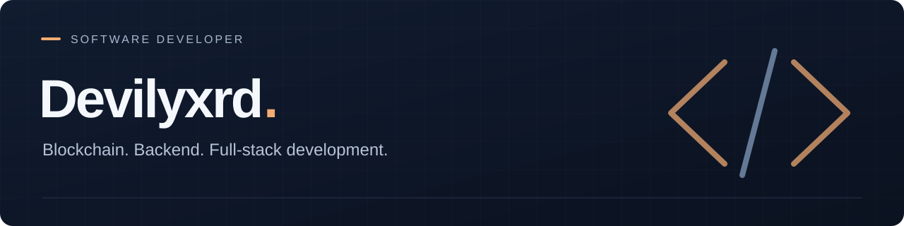

# Hi, I'm Kaan.

I'm a software developer working across **blockchain, backend systems, and full-stack applications**.

I take software projects from initial requirements to launch, handling analysis, UI/UX design, frontend and backend development, system and database architecture, integrations, testing, and deployment.

[LinkedIn](https://www.linkedin.com/in/kaan-atalay-274b00263/)

## Selected work

### Devilyxrd Blockchain System
**Blockchain · Personal R&D · In development**

A permissioned blockchain platform covering consensus, wallet services, and smart-contract execution. I'm developing its next iteration with a modular architecture built around **TypeScript, NestJS, and Go**.

### BGB — Gambling Harm Prevention Platform
**Full-stack product development**

A platform focused on reducing gambling-related harm. I handled the product's analysis, design, and development end to end, including the mobile application, backend algorithms, admin panel, and web interface.

### Dr. Kadir Yücebaş — Clinic Application System
**Web application · Workflow management**

A bilingual pre-assessment and appointment application system for a medical practice, bringing together public-facing forms, an admin panel, application status tracking, and automated notifications.

## What I work on

- **Product design & frontend** — requirements analysis, UI/UX design, and web interfaces with React, Next.js, and TypeScript.
- **Backend systems** — application architecture, databases, APIs, and service integrations.
- **Infrastructure & deployment** — testing, containerization, server configuration, and production deployment.
- **Blockchain & backend architecture** — permissioned networks, service design, and APIs.
- **IoT** — connected devices with MQTT, Arduino, and Raspberry Pi.

## Toolbox

| Area | Technologies |
| :--- | :--- |
| Web | TypeScript, JavaScript, React, Next.js, Tailwind CSS |
| Backend | Node.js, NestJS, Express, Go, Python, FastAPI, Flask |
| Data | PostgreSQL, MySQL, MongoDB, Redis, SQLite, Firebase |
| Infrastructure | Linux, Docker, Kubernetes, Nginx, AWS, Cloudflare, Git |
| Hardware & messaging | MQTT, Arduino, ESP, Raspberry Pi |

More languages and tools

- **Languages:** PHP, Java, C, C++, C#, Dart
- **Web foundations & tooling:** HTML, CSS, Sass, Bootstrap, Vite
- **Cross-platform & design:** Flutter, Figma

## Let's work together

Have a project in mind? Reach out for **freelance projects, development opportunities, or technical collaborations**.

From a business website to a complete web application, I can handle **design, development, and deployment end to end**. Tell me what you want to build and where things stand.

**[Connect on LinkedIn](https://www.linkedin.com/in/kaan-atalay-274b00263/)**

---

Elsewhere: <a href="https://x.com/Devilyxrd">X</a> · <a href="https://instagram.com/Devilyxrd">Instagram</a> · <a href="https://open.spotify.com/user/31wkss7c2lcsk6zjupynod725c6y">Spotify</a>
